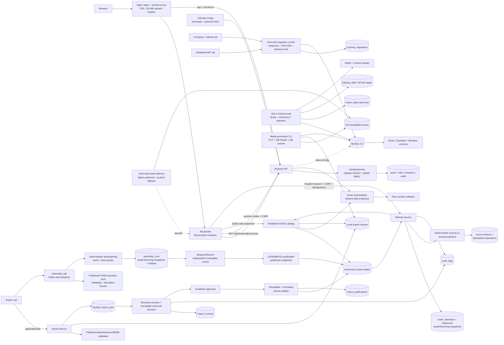

# Kiến trúc

## Hiện tại

Backend được giữ modular monolith để phù hợp repo nhỏ. `backend/src/domain` chứa logic thuần; route chỉ chuyển HTTP. Frontend không render raw HTML/SVG từ payload. Asset DEMO là SVG nội bộ tin cậy; asset import tương lai phải sanitize/convert và phục vụ từ storage.

Runtime production parse/validate toàn bộ boolean/integer/origin quan trọng trước khi listen. `NODE_ENV=production` bắt buộc HTTPS origin, secure cookie và database password không mặc định. Express chỉ tin số proxy hop được cấu hình; liveness không chạm DB, readiness phụ thuộc DB và trạng thái draining. SIGTERM/SIGINT chỉ xử lý một lần, ngừng readiness rồi đóng realtime/HTTP/pool trong deadline hữu hạn. Nginx phục vụ static cùng CSP/security headers và không gọi font CDN bên thứ ba.

`backend/src/operations/migration-runner.js` là upgrade boundary trước backend. Runner yêu cầu file `NNN_name.sql` liên tục, hash SHA-256 bất biến, giữ MySQL advisory lock theo database và ghi từng kết quả `APPLIED | ADOPTED | SKIPPED | BOOTSTRAPPED` vào `schema_migrations`. Compose không giao schema cho entrypoint MySQL; one-shot `migrate` hoàn tất mới mở backend. Database cũ không ledger bị chặn cho đến khi operator backup/xác minh và dùng `--adopt-existing`; sentinel schema ngăn adopt prefix thiếu hoặc không nhất quán. Seed DEMO bị skip mặc định. Vì MySQL DDL implicit-commit, restore rehearsal và recovery có review vẫn là bắt buộc.

`ops/backup` là data-protection boundary opt-in, được đóng gói thành image riêng trong CI/GHCR. Loop tạo MySQL single-transaction dump trước, rồi archive local import volume chỉ đọc; mỗi set có manifest, ledger/schema invariants, SHA-256 và `READY` marker cuối cùng. Lock chống concurrent run, retention chỉ chạm complete set, health fail khi failure mới hơn success hoặc set quá tuổi. Restore checker chỉ nhận database prefix `eduassess_restore_`, yêu cầu xác nhận drop chính xác, so ledger/invariants và cleanup target. Compose `backup_data` là local baseline; encryption, off-site replication và alert delivery thuộc deployment.

`backend/src/imports` có repository/storage adapters. Runtime dùng MySQL + local persistent volume; tests dùng repository memory + thư mục tạm. ZIP được đọc trong bộ nhớ ở giới hạn request 25 MiB, giải nén logic tối đa 50 MiB và không ghi entry ra filesystem. Gói có path/symlink/encryption/tỷ lệ nén nguy hiểm bị từ chối trước staging.

`backend/src/auth` xác thực password scrypt, tạo opaque session/CSRF token và chỉ lưu hash token trong MySQL. Cookie session là `HttpOnly`, `SameSite=Strict`; role guard chạy phía server. Import ghi creator/audit trong transaction. Preview không lưu bản nội dung mới: service đọc lại `source.zip`, dựng projection reviewer và phục vụ asset theo `assetId` với `no-store`. Technical và academic decision khóa ImportJob bằng `SELECT ... FOR UPDATE`, cấm creator tự review và ghi hai scope bất biến trong `import_reviews`.

Publish đọc lại archive, xác minh source SHA-256, revalidate và so canonical report hash với approval. `package-publication.js` dựng plan UUID nội bộ, đổi rich asset/answer-option references và giữ stable identity để tạo version kế tiếp. Repository khóa job và commit source/license/assets/stimuli/questions/groups/exam/publication/audit/status trong một transaction. Nếu bất kỳ insert nào lỗi, toàn bộ rollback; nếu client retry sau commit, `import_publications.import_job_id` trả lại publication cũ. `storage_key` tiếp tục là archive reference bất biến; object promotion không rewrite/xóa source này.

`backend/src/storage` là media delivery boundary. Asset `ARCHIVE` đọc source ZIP; asset `OBJECT` ưu tiên GET object content-addressed và xác minh size/SHA-256, rồi mới fallback archive khi flag cho phép. Promotion xác minh archive, dùng conditional PUT, GET/read-after-write verification rồi transactionally đổi `storage_backend` và ghi event/audit. DB không bao giờ trỏ object chưa verify. Rollback xác minh lại archive trước transaction, giữ object key/bytes để retry và đánh dấu rollback để batch không tự promote lại. `media_asset_storage_events` là ledger bất biến; operator dùng CLI thay vì SQL tay.

`backend/src/catalog` chỉ đọc ExamVersion `PUBLISHED + non-formal`. FIXED dựng lại relational graph rồi chạy student-safe presentation; ASSEMBLED đọc immutable publication snapshot và kiểm tra hash/metadata binding. Projection loại answer/explanation. Public asset query chỉ chấp nhận reference student-visible từ FIXED graph hoặc ASSEMBLED student snapshot, sau đó xác minh bytes với metadata hash/size.

`backend/src/attempts` tạo hai snapshot tách biệt: student snapshot được trả cho player, scoring snapshot chứa answer key chỉ nằm server-side. Cả hai được canonical-hash; create transaction khóa lại ExamVersion, ghi attempt + audit nguyên tử và unique `(student_user_id, idempotency_key)`. Service đọc idempotency record trước khi dựng snapshot để retry luôn nhận đúng bản cũ dù catalog đã thay đổi. Lookup luôn scope theo owner.

Autosave dùng optimistic concurrency với `answer_revision`: repository khóa owned attempt, replay operation cũ theo `(student, operation type, idempotency key, request hash)`, rồi patch response map + tăng revision + ghi ACK/audit trong cùng transaction. Read attempt/result dùng một repeatable-read transaction để metadata, responses và score không bị xé giữa hai commit.

Submit khóa attempt, chỉ chấm response đã commit và tạo một immutable `attempt_score_revisions` row bằng `eduassess-scoring-v1`. Public result là projection riêng: PRACTICE final mới có correct answer; mock/diagnostic/pending chỉ có summary, không bao giờ map raw scoring snapshot, explanation hoặc essay rubric. Answered essay chuyển sang manual pending; assessment/competency interpretation vẫn là boundary khác.

`backend/src/assembly` tách engine thuần, service projection/hash/governance và MySQL repository. Repository lọc QuestionVersion published thuộc graph FIXED non-formal, provenance/license derivative còn hiệu lực và metadata assembly đầy đủ. Engine biến direct/atomic/split group thành selection unit, sắp thứ tự bằng seeded SHA-256 rank rồi backtrack hard constraints. Service lưu student/scoring snapshot riêng cùng selection/snapshot hash. BlueprintVersion cần Reviewer độc lập; review bind hashes. Publication transaction tạo ExamVersion ASSEMBLED cùng published snapshot/hash/audit. Catalog dispatch theo mode: FIXED dựng graph, ASSEMBLED đọc snapshot; attempt dùng chung flow và không gọi engine.

## Boundaries kế tiếp

`import`, `catalog`, `exam-player`, `attempt`, `scoring`, `assembly`, `assessment`, `identity/access`, `audit`, `operations`. Attempt/scoring, ASSEMBLED delivery, runtime safety, migration, backup/restore automation và S3-compatible promotion baseline đã có; identity vẫn mới global role. Off-site/alert deployment, CDN/telemetry, Blueprint authoring revision, tenant/school scope và manual scoring/regrade là boundary tiếp theo. Không tách microservice trước khi có nhu cầu vận hành thực.
