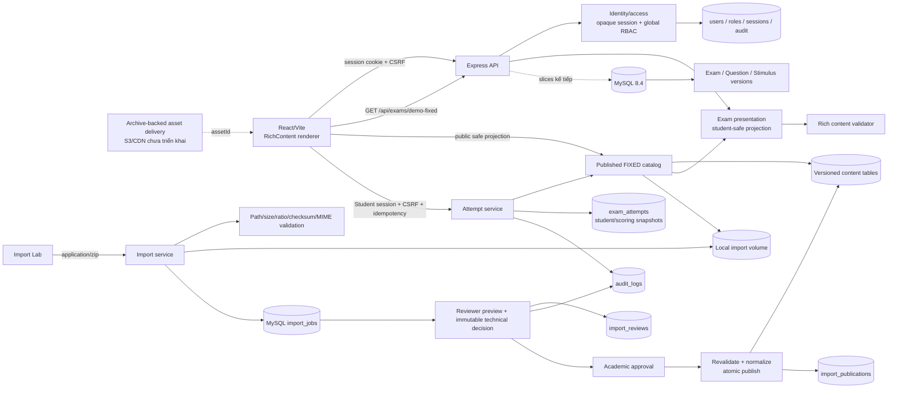

# Kiến trúc

## Hiện tại

Backend được giữ modular monolith để phù hợp repo nhỏ. `backend/src/domain` chứa logic thuần; route chỉ chuyển HTTP. Frontend không render raw HTML/SVG từ payload. Asset DEMO là SVG nội bộ tin cậy; asset import tương lai phải sanitize/convert và phục vụ từ storage.

`backend/src/imports` có repository/storage adapters. Runtime dùng MySQL + local persistent volume; tests dùng repository memory + thư mục tạm. ZIP được đọc trong bộ nhớ ở giới hạn request 25 MiB, giải nén logic tối đa 50 MiB và không ghi entry ra filesystem. Gói có path/symlink/encryption/tỷ lệ nén nguy hiểm bị từ chối trước staging.

`backend/src/auth` xác thực password scrypt, tạo opaque session/CSRF token và chỉ lưu hash token trong MySQL. Cookie session là `HttpOnly`, `SameSite=Strict`; role guard chạy phía server. Import ghi creator/audit trong transaction. Preview không lưu bản nội dung mới: service đọc lại `source.zip`, dựng projection reviewer và phục vụ asset theo `assetId` với `no-store`. Technical và academic decision khóa ImportJob bằng `SELECT ... FOR UPDATE`, cấm creator tự review và ghi hai scope bất biến trong `import_reviews`.

Publish đọc lại archive, xác minh source SHA-256, revalidate và so canonical report hash với approval. `package-publication.js` dựng plan UUID nội bộ, đổi rich asset/answer-option references và giữ stable identity để tạo version kế tiếp. Repository khóa job và commit source/license/assets/stimuli/questions/groups/exam/publication/audit/status trong một transaction. Nếu bất kỳ insert nào lỗi, toàn bộ rollback; nếu client retry sau commit, `import_publications.import_job_id` trả lại publication cũ. Media storage key hiện là archive-backed (`source.zip#entry`), nên source ZIP published không được cleanup trước khi có object-storage promotion.

`backend/src/catalog` chỉ đọc graph `PUBLISHED + FIXED + non-formal`, dựng lại full internal exam rồi chạy cùng student-safe presentation. Projection loại answer/explanation và lọc cả asset chỉ xuất hiện trong lời giải. Public asset query chỉ chấp nhận reference student-visible từ một published exam, sau đó xác minh bytes với metadata hash/size.

`backend/src/attempts` tạo hai snapshot tách biệt: student snapshot được trả cho player, scoring snapshot chứa answer key chỉ nằm server-side. Cả hai được canonical-hash; create transaction khóa lại ExamVersion, ghi attempt + audit nguyên tử và unique `(student_user_id, idempotency_key)`. Service đọc idempotency record trước khi dựng snapshot để retry luôn nhận đúng bản cũ dù catalog đã thay đổi. Lookup luôn scope theo owner.

## Boundaries kế tiếp

`import`, `catalog`, `exam-player`, `attempt`, `scoring`, `assembly`, `assessment`, `identity/access`, `audit`. Identity hiện mới global role; tenant/school scope, autosave/submit và reveal policy là boundary tiếp theo. Không tách microservice trước khi có nhu cầu vận hành thực.
