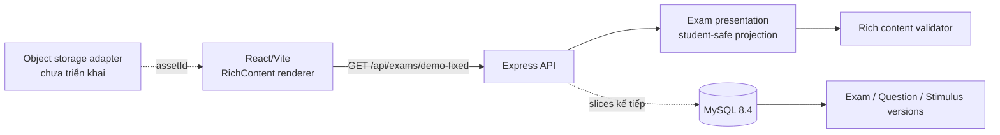

# Kiến trúc

## Hiện tại

Backend được giữ modular monolith để phù hợp repo nhỏ. `backend/src/domain` chứa logic thuần; route chỉ chuyển HTTP. Frontend không render raw HTML/SVG từ payload. Asset DEMO là SVG nội bộ tin cậy; asset import tương lai phải sanitize/convert và phục vụ từ storage.

## Boundaries kế tiếp

`import`, `catalog`, `exam-player`, `scoring`, `assembly`, `assessment`, `identity/access`, `audit`. Không tách microservice trước khi có nhu cầu vận hành thực.
