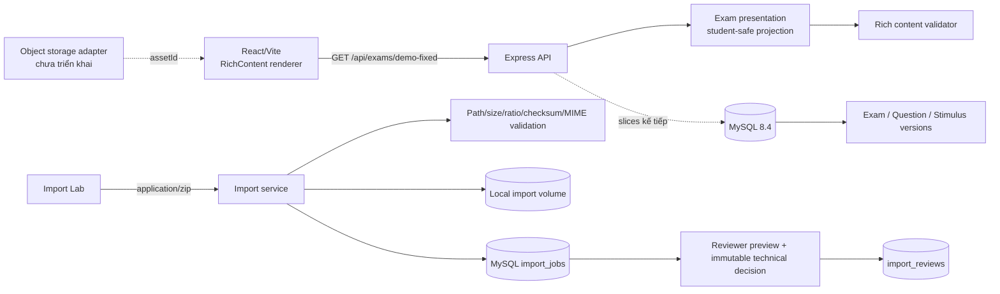

# Kiến trúc

## Hiện tại

Backend được giữ modular monolith để phù hợp repo nhỏ. `backend/src/domain` chứa logic thuần; route chỉ chuyển HTTP. Frontend không render raw HTML/SVG từ payload. Asset DEMO là SVG nội bộ tin cậy; asset import tương lai phải sanitize/convert và phục vụ từ storage.

`backend/src/imports` có repository/storage adapters. Runtime dùng MySQL + local persistent volume; tests dùng repository memory + thư mục tạm. ZIP được đọc trong bộ nhớ ở giới hạn request 25 MiB, giải nén logic tối đa 50 MiB và không ghi entry ra filesystem. Gói có path/symlink/encryption/tỷ lệ nén nguy hiểm bị từ chối trước staging.

Preview không lưu bản nội dung mới: service đọc lại `source.zip`, dựng projection reviewer và phục vụ asset theo `assetId` với `no-store`. Technical decision chạy trong transaction `SELECT ... FOR UPDATE`, ghi một immutable `import_reviews` row và đổi ImportJob sang `TECHNICALLY_APPROVED` hoặc `REJECTED`. Không có transition sang `PUBLISHED` trong module này.

## Boundaries kế tiếp

`import`, `catalog`, `exam-player`, `scoring`, `assembly`, `assessment`, `identity/access`, `audit`. Không tách microservice trước khi có nhu cầu vận hành thực.
