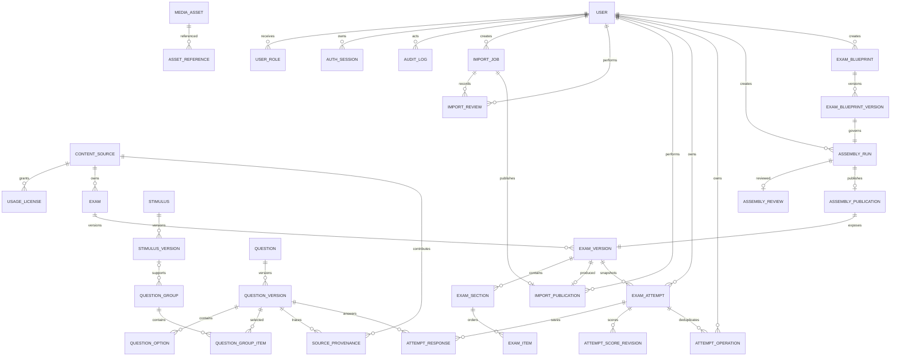

# Data model

Migration nền tảng: `database/init/002_eduassess_foundation.sql`; attempt snapshot: `007_attempt_snapshots.sql`; response/scoring: `008_attempt_scoring.sql`; assembly foundation: `009_assembly_foundation.sql`; blueprint governance/publication: `010_assembled_publication.sql`.

Published versions phải bất biến ở application/service layer; thay đổi tạo version mới. `ExamItem` có check đúng một target. JSON dành cho rich content/answer config đã được validate; grade/subject/type/status là cột quan hệ để lọc.

`users` giữ identity trạng thái; password chỉ lưu scrypt hash. `user_roles` hiện chỉ có global scope. `auth_sessions` lưu hash của opaque session/CSRF token, expiry và revoke timestamp; `audit_logs` lưu event/outcome/resource mà không lưu raw credential/token.

`import_jobs.created_by_user_id` xác định creator. `import_reviews` có hai scope `TECHNICAL | ACADEMIC`, unique theo `(import_job_id, review_scope)`, lưu decision/reason/reviewer ID/report SHA-256/package SHA-256/actor source; transaction cấm creator tự review.

`import_publications` unique theo ImportJob và ExamVersion, lưu publisher cùng hai hash đã duyệt. Publication transaction tạo content source/license/media, các identity + version rows, section/item/group/provenance/asset reference, rồi mới đổi job sang `PUBLISHED`. Stable exam/question/stimulus key nhận version number kế tiếp; published rows không update. Formal assessment vẫn bị khóa ở service policy.

`exam_attempts` giữ owner Student, ExamVersion, state, idempotency key, monotonic `answer_revision`, score revision pointer và hai JSON snapshot riêng. Unique `(student_user_id, idempotency_key)` chống duplicate create. `student_snapshot_json` không có answer/explanation; `scoring_snapshot_json` có version/type/points/option IDs/answer key và không được map ra public response. `snapshot_sha256` bao phủ canonical JSON của cả hai.

`attempt_responses` là response map hiện tại theo `(attempt, question_version)`; mỗi row ghi revision đã ACK. `attempt_operations` lưu request hash + exact JSON response cho AUTOSAVE/SUBMIT và unique theo `(student, operation_type, idempotency_key)`, nên retry không chạy side effect lần hai. `attempt_score_revisions` là lịch sử điểm bất biến theo `(attempt, revision_number)`, có scoring state/version/result và actor type; submit đầu tiên tạo revision 1, còn regrade chưa triển khai. Tạo attempt, autosave và submit đều ghi audit trong cùng transaction với thay đổi nghiệp vụ.

Migration 009 bổ sung các cột relational/indexed trên `question_versions`: curriculum, topic, skill, difficulty, estimated time và family key. Metadata thiếu không làm hỏng FIXED, nhưng row không eligible cho assembly.

`assembly_runs` lưu creator/idempotency request hash, canonical blueprint, seed, engine version, selection manifest/source distribution, student/scoring snapshot tách riêng và hai hash toàn vẹn. Unique `(created_by_user_id, idempotency_key)` chống duplicate retry; chỉ run `SUCCEEDED` được lưu. Lỗi pool trả có cấu trúc nhưng chưa persist rejection run. Technical snapshot chỉ trở thành catalog/attempt source sau review + publication record.

Migration 010 cho phép `exams.source_id` nullable riêng cho ASSEMBLED nhiều nguồn; provenance thật vẫn nằm trên từng QuestionVersion/selection manifest. `exam_blueprints` giữ identity, `exam_blueprint_versions` giữ JSON version bất biến + approval status. Mỗi run gắn đúng một version; run có trước reviewer-payload contract được backfill thành version 1 `REJECTED` và phải assemble lại, không được mở publish gate âm thầm.

`assembly_reviews` unique theo run, bind reviewer/decision/reason với selection + source snapshot hashes. `assembly_publications` unique theo run/blueprint/exam version, lưu published student/scoring snapshots + hash và publisher. Publish tạo `exam_versions.mode=ASSEMBLED`; không tạo ExamSection/Item bản sao vì frozen publication snapshot là source of truth. Attempt vẫn FK cùng ExamVersion và sao chép publication snapshot vào attempt.
