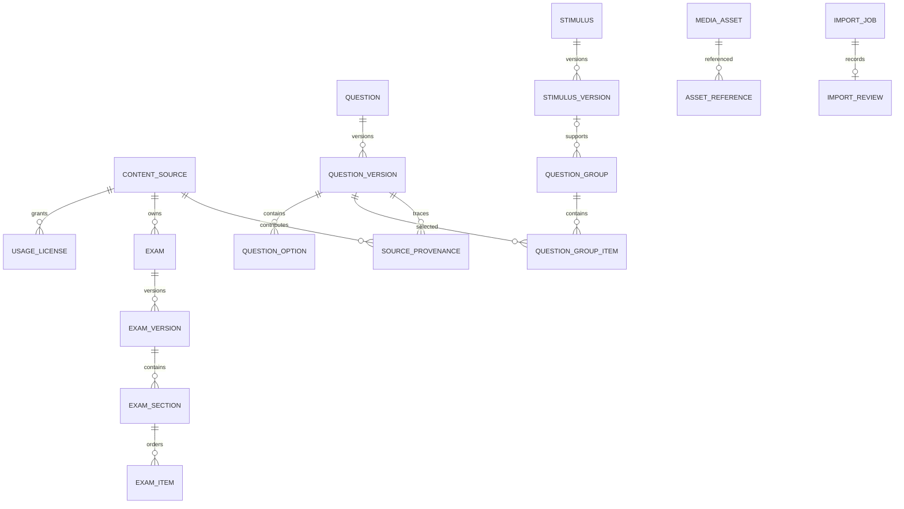

# Data model

Migration nền tảng: `database/init/002_eduassess_foundation.sql`.

Published versions phải bất biến ở application/service layer; thay đổi tạo version mới. `ExamItem` có check đúng một target. JSON dành cho rich content/answer config đã được validate; grade/subject/type/status là cột quan hệ để lọc. Attempt/snapshot sẽ được thêm trong Phase 2 trước khi có submit thật.

`import_reviews` chỉ có scope `TECHNICAL` trong slice hiện tại, unique theo `import_job_id`, lưu decision/reason/reviewer ID/report SHA-256/actor source. Academic approval cần identity + role riêng và chưa tồn tại.
