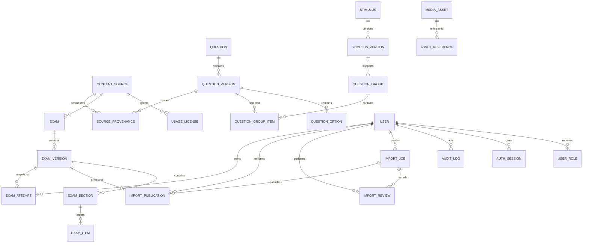

# Data model

Migration nền tảng: `database/init/002_eduassess_foundation.sql`; attempt snapshot: `database/init/007_attempt_snapshots.sql`.

Published versions phải bất biến ở application/service layer; thay đổi tạo version mới. `ExamItem` có check đúng một target. JSON dành cho rich content/answer config đã được validate; grade/subject/type/status là cột quan hệ để lọc.

`users` giữ identity trạng thái; password chỉ lưu scrypt hash. `user_roles` hiện chỉ có global scope. `auth_sessions` lưu hash của opaque session/CSRF token, expiry và revoke timestamp; `audit_logs` lưu event/outcome/resource mà không lưu raw credential/token.

`import_jobs.created_by_user_id` xác định creator. `import_reviews` có hai scope `TECHNICAL | ACADEMIC`, unique theo `(import_job_id, review_scope)`, lưu decision/reason/reviewer ID/report SHA-256/package SHA-256/actor source; transaction cấm creator tự review.

`import_publications` unique theo ImportJob và ExamVersion, lưu publisher cùng hai hash đã duyệt. Publication transaction tạo content source/license/media, các identity + version rows, section/item/group/provenance/asset reference, rồi mới đổi job sang `PUBLISHED`. Stable exam/question/stimulus key nhận version number kế tiếp; published rows không update. Formal assessment vẫn bị khóa ở service policy.

`exam_attempts` giữ owner Student, ExamVersion, state, idempotency key và hai JSON snapshot riêng. Unique `(student_user_id, idempotency_key)` chống duplicate retry. `student_snapshot_json` không có answer/explanation; `scoring_snapshot_json` có version/type/points/answer key và không được map ra public response. `snapshot_sha256` bao phủ canonical JSON của cả hai; tạo attempt và `ATTEMPT_STARTED` audit cùng transaction. Slice hiện tại mới có `IN_PROGRESS`; các status còn lại dành cho submit/scoring kế tiếp.
